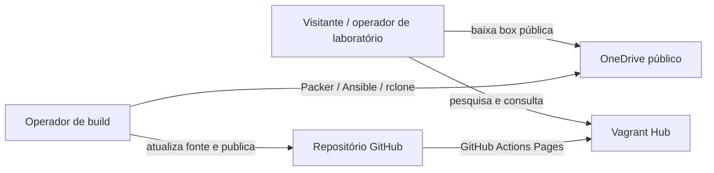
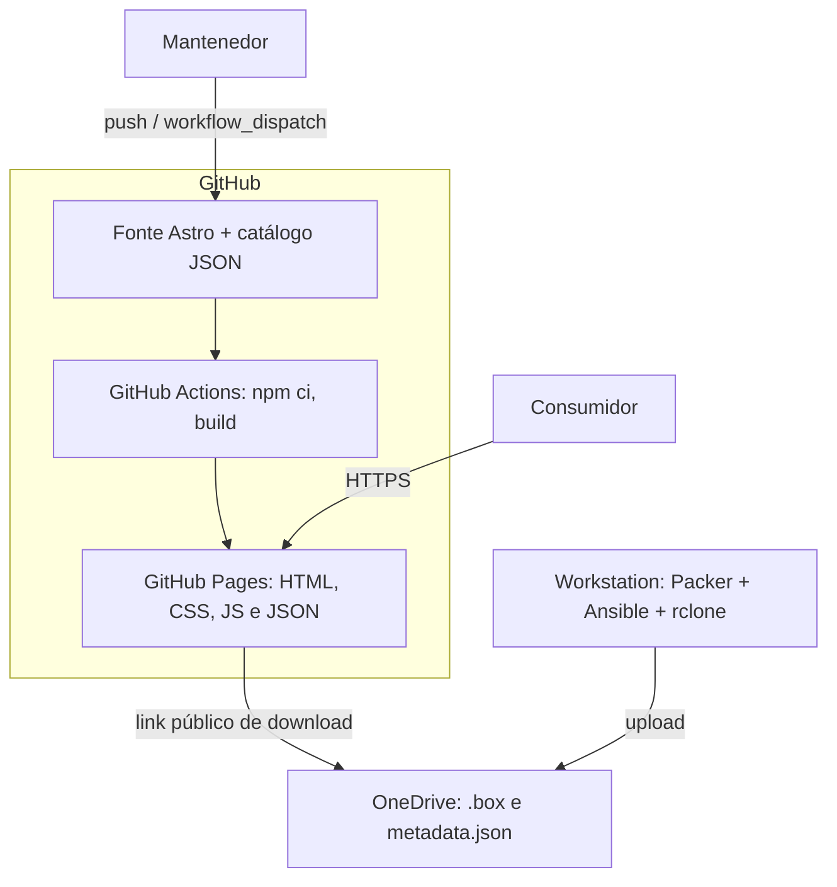

# C4: arquitetura do portal

## Nível 1 — Contexto

## Nível 2 — Containers

## Nível 3 — Componentes do container Portal

- `src/pages/`: home, catálogo, detalhes e página 404.
- `src/components/`: header, footer, layout, cards e ícones.
- `src/data/catalog.json`: dados estáticos renderizados no build.
- `src/scripts/site.ts`: busca local, menu mobile e ações de copiar.
- `src/styles/global.css`: tokens da paleta, componentes visuais e breakpoints responsivos.

## Nível 4 — Código

As páginas Astro são geradas em build-time. O único código cliente é TypeScript leve para interações. Não há API, sessão, banco de dados nem segredo enviado ao browser.
